# 🎟️ EventBook – Event & Movie Ticket Booking System


A full-stack ticket booking platform (similar to BookMyShow): people browse movies and events,
pick seats on a live seat map, pay through a mock payment gateway and manage their bookings.
Organizers create events, venues and shows; admins manage users and see analytics.

| | Link |
|---|---|
| 🌐 **Live website** | **https://eventbook-ek9t.onrender.com** |
| ⚙️ Live REST API | https://event-booking-system-3-x07x.onrender.com |
| 📖 API docs (Swagger) | https://event-booking-system-3-x07x.onrender.com/swagger-ui/index.html |
| 📄 Endpoint reference | [docs/API.md](docs/API.md) |

> ⏳ The app runs on Render's free plan, which sleeps when idle. **The first request can take about a minute** while the server wakes up; after that it is fast.

---

## Contents

1. [Try it – demo accounts](#1-try-it--demo-accounts)
2. [Screenshots](#2-screenshots)
3. [Features](#3-features)
4. [Tech stack](#4-tech-stack)
5. [Architecture](#5-architecture)
6. [Database design](#6-database-design)
7. [How a booking works](#7-how-a-booking-works)
8. [Seat locking – no double booking](#8-seat-locking--no-double-booking)
9. [Security](#9-security)
10. [Project structure](#10-project-structure)
11. [Run it on your computer](#11-run-it-on-your-computer)
12. [Testing](#12-testing)
13. [Deployment](#13-deployment)
14. [Work log – what was built and fixed](#14-work-log--what-was-built-and-fixed)
15. [Limitations and future work](#15-limitations-and-future-work)

---

## 1. Try it – demo accounts

The live database is pre-loaded with demo data: **6 movies** (Harry Potter, The Lord of the Rings, Marvel),
**5 well-known cinemas** (Prasads IMAX & AMB Cinemas Hyderabad, PVR ICON Mumbai, Sathyam Chennai, Raj Mandir Jaipur),
**60 shows** and some bookings.

| Role | Email | Password | What to try |
|---|---|---|---|
| User | `priya.reddy@demo.eventbook.in` | `Demo@1234` | Open a movie → *Book seats* → pick seats → *Pay* → *My Bookings* → *Cancel* |
| User | `aarav.sharma@demo.eventbook.in` | `Demo@1234` | Already has 2 confirmed bookings |
| User | `rohan.verma@demo.eventbook.in` | `Demo@1234` | |
| Organizer | `organizer@demo.eventbook.in` | `Demo@1234` | *Manage* → dashboard, create an event / venue / seat layout / show |

You can also **sign up** with any email – new accounts get the USER role.
(The admin account is private; screenshots of the admin page are below.)

---

## 2. Screenshots

| Home – browse events | Event page – choose a show |
|---|---|
| 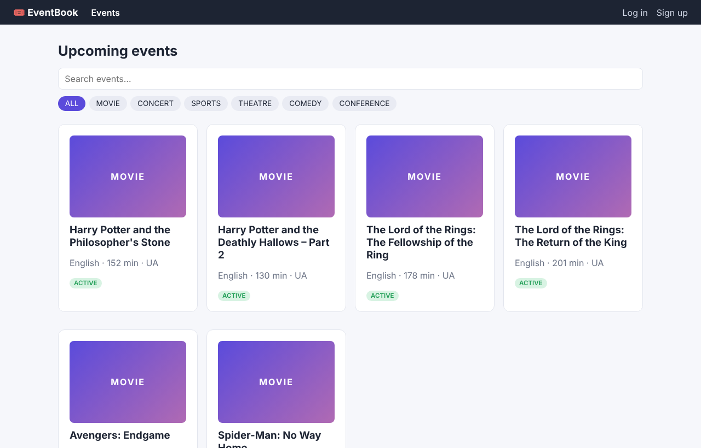 | 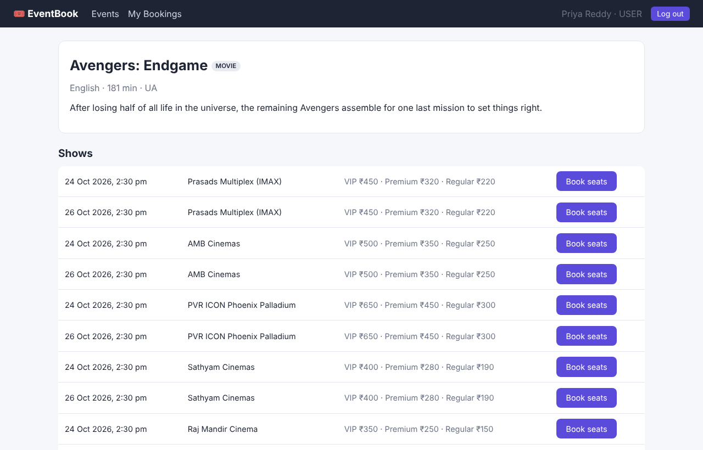 |
| **Seat map – pick seats (VIP / Premium / Regular)** | **Payment – mock gateway, 5-minute seat hold** |
| 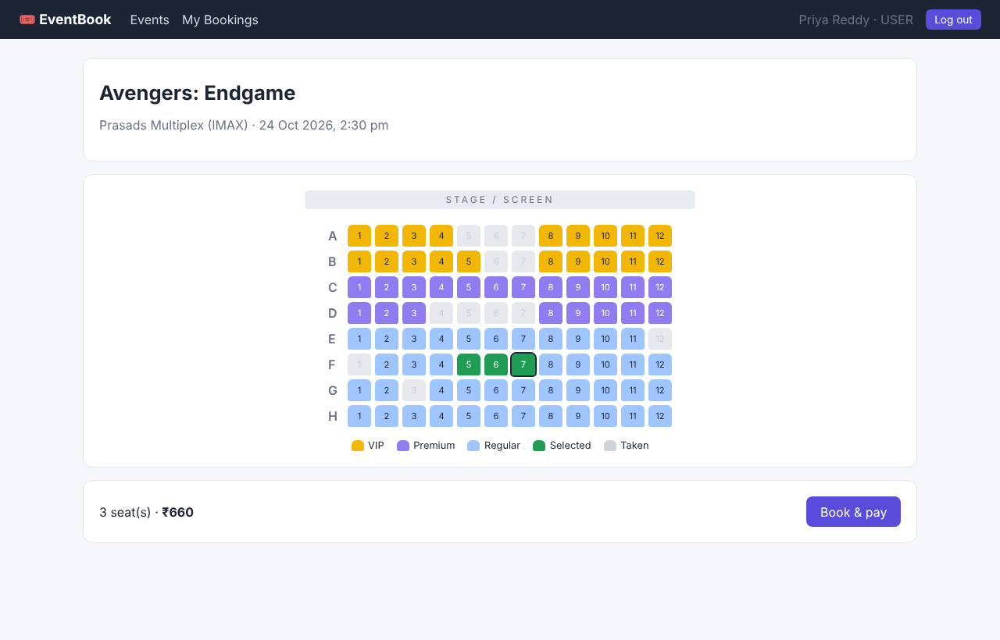 | 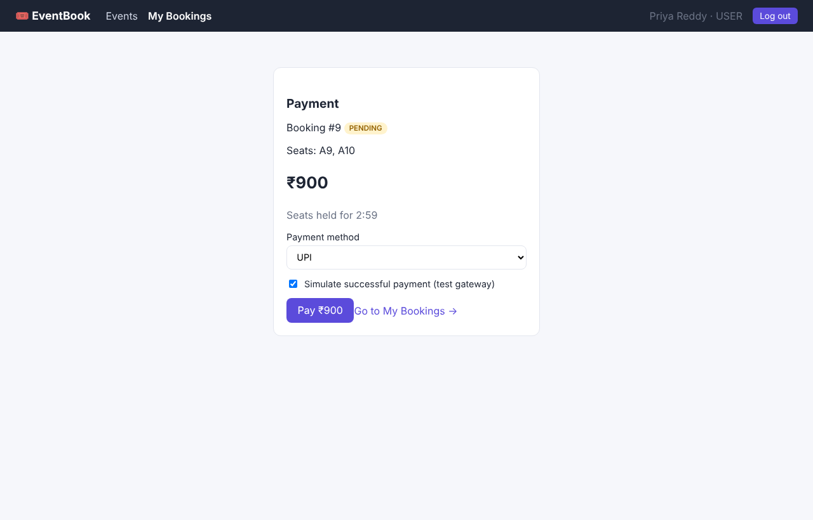 |
| **My bookings – stats, pay, cancel** | **Organizer dashboard** |
| 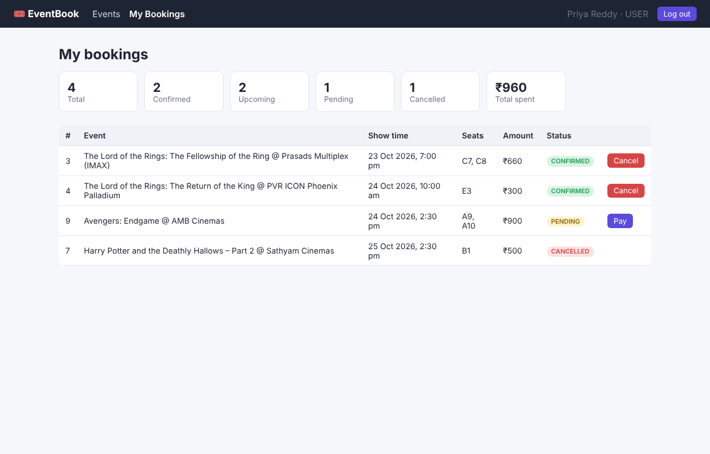 | 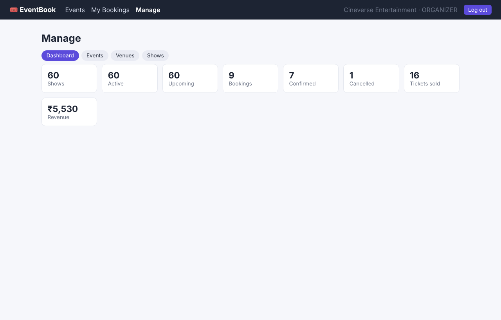 |
| **Organizer – create and list shows** | **Admin – totals, analytics, user roles** |
| 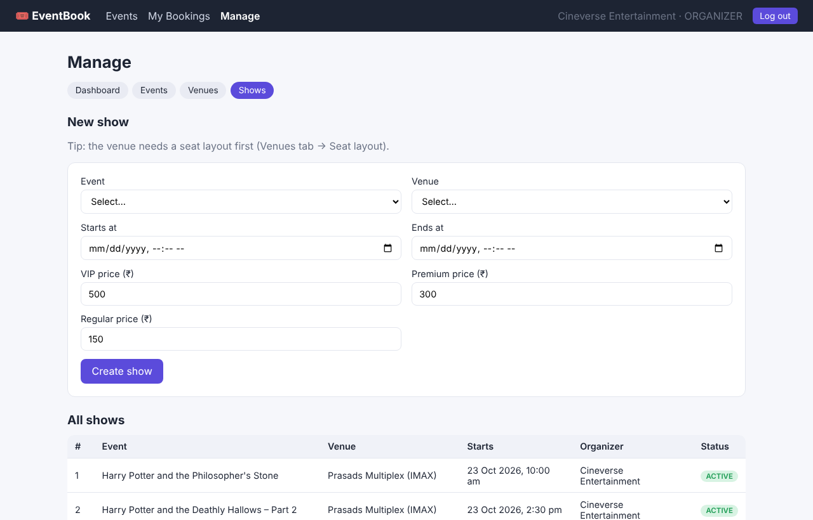 | 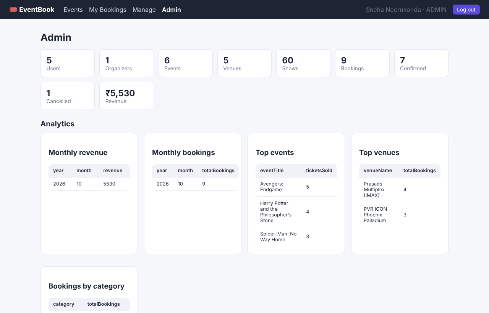 |

---

## 3. Features

### For everyone
- Browse all events, search by name, filter by category (Movie, Concert, Sports, Theatre, Comedy, Conference)
- Sign up and log in (JWT token)

### 👤 User
- See all shows of an event (date, cinema, prices)
- **Interactive seat map** – seats coloured by type, taken seats greyed out
- Book seats → seats are **locked for 5 minutes** while you pay
- Pay with UPI / Card / Net banking / Wallet through a **mock payment gateway** (can simulate success or failure)
- My Bookings: personal stats (total, confirmed, upcoming, total spent), pay pending bookings, **cancel with refund**

### 🎬 Organizer
- Dashboard: shows, tickets sold, revenue
- Create / edit / delete events and venues
- **Generate a seat layout** for a venue (rows A–Z, VIP / Premium / Regular rows)
- Create shows with **three price tiers**; the system rejects **overlapping shows** at the same venue

### 🛡️ Admin
- Everything an organizer can do
- System dashboard: users, organizers, events, venues, shows, bookings, revenue
- Analytics: monthly revenue, monthly bookings, top events, top venues, bookings by category
- Manage users and **change roles** (USER ↔ ORGANIZER ↔ ADMIN)

### Behind the scenes
- **Double-booking prevention** – seat locking with transactions + optimistic locking (`@Version`), proven by a live race test ([details](#8-seat-locking--no-double-booking))
- **Scheduler** cancels unpaid bookings after 5 minutes and frees the seats
- Soft delete for events and venues (history is kept)
- Consistent error responses with correct HTTP status codes
- Demo data loader for an empty database

---

## 4. Tech stack

| Layer | Technology | Why |
|---|---|---|
| Frontend | React 19, React Router, Vite, plain CSS | Fast single-page app, simple to understand |
| Backend | Java 21, Spring Boot 3.5 (Web, Data JPA, Validation, Security) | Industry-standard REST framework |
| Auth | Spring Security + JWT (jjwt), BCrypt | Stateless login, hashed passwords |
| Database | PostgreSQL, Hibernate ORM | Relational data with strong consistency |
| API docs | springdoc-openapi (Swagger UI) | Try every endpoint in the browser |
| Build | Maven, Docker (multi-stage) | Repeatable builds |
| Hosting | Render (Web Service + Static Site + PostgreSQL) | Free cloud hosting with auto-deploy from GitHub |

---

## 5. Architecture

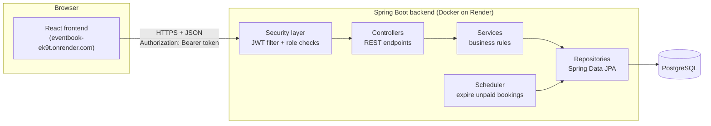

The backend follows a classic **layered architecture**:

| Layer | Package | Responsibility |
|---|---|---|
| Controller | `controller` | Receives HTTP requests, validates input, returns JSON |
| Service | `service` | Business rules (seat availability, overlap checks, payments, refunds) |
| Repository | `repository` | Database queries (Spring Data JPA + Specifications for filters) |
| Entity | `entity` | Database tables as Java classes |
| DTO + Mapper | `dto`, `mapper` | What the API sends/receives, kept separate from entities |
| Security | `security` | JWT creation/validation, CORS, role rules |

The original design diagram (drawn when the project was planned with MySQL) is in [images/architecture.png](images/architecture.png).

---

## 6. Database design

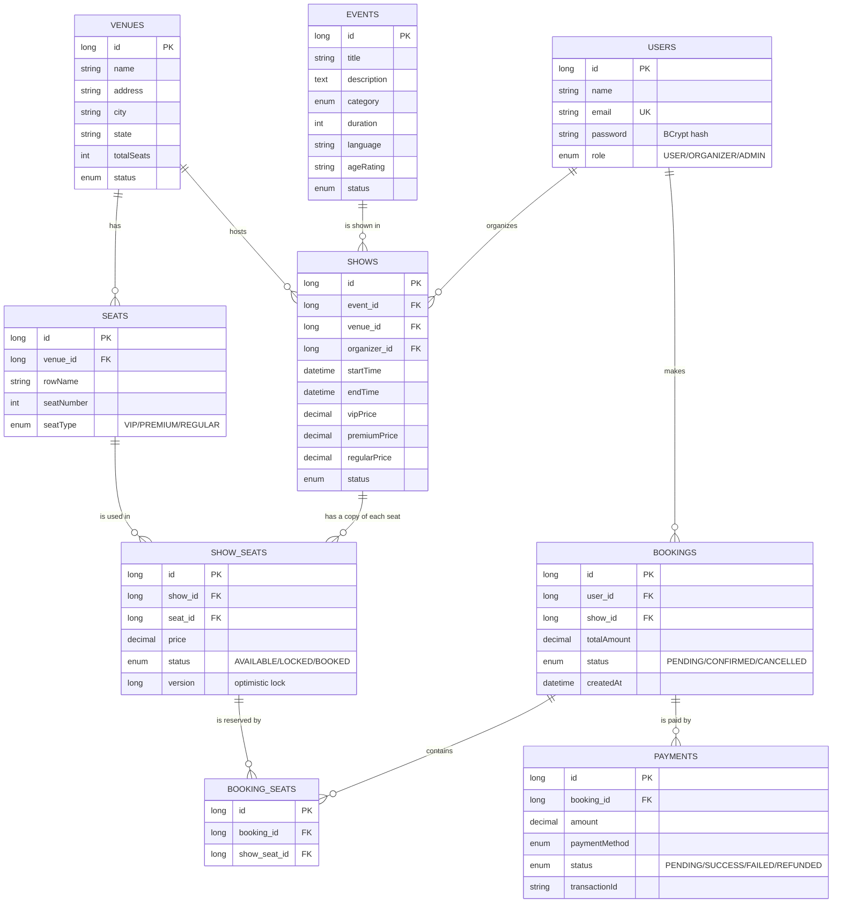

**Key idea – `seats` vs `show_seats`:** a venue's physical seats are stored once in `seats`.
When a show is created, every seat is copied into `show_seats` with that show's price and its own status.
This way the same seat A5 can be *booked* for the 10 AM show but still *available* for the 7 PM show.

Tables are created automatically by Hibernate (`spring.jpa.hibernate.ddl-auto=update`).

---

## 7. How a booking works

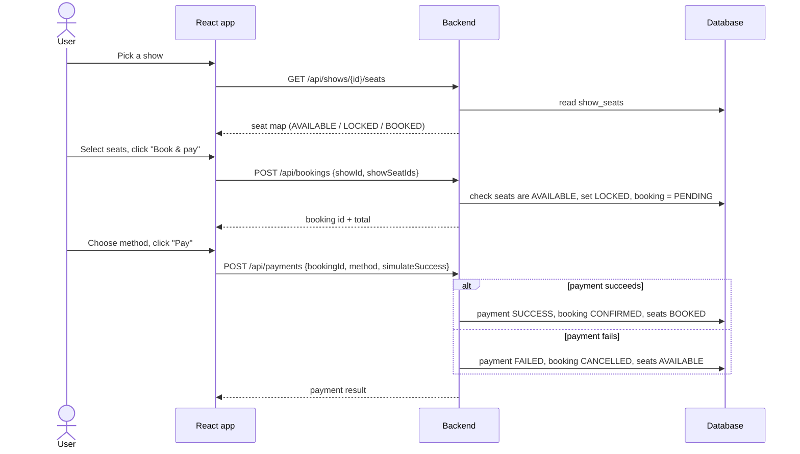

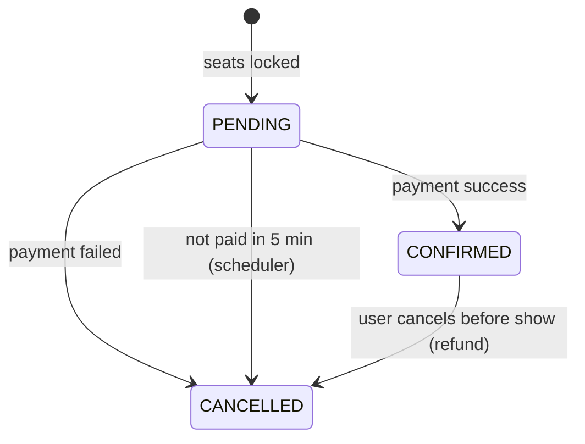

---

## 8. Seat locking – no double booking

**The problem:** a popular show opens, and two (or a hundred) people click the *same seat* at the same moment.
Without protection, both could pay for seat H8 and arrive at the cinema with the same ticket.

**How EventBook prevents it – three layers of protection:**

| Layer | What it does | Where in the code |
|---|---|---|
| 1. Status check inside a transaction | Each seat of a show has a status: `AVAILABLE`, `LOCKED` or `BOOKED`. Booking checks that every chosen seat is still `AVAILABLE`, then marks it `LOCKED` – all inside one database **transaction** (all-or-nothing: if any step fails, nothing is saved). | `BookingService.createBooking` (class is `@Transactional`) |
| 2. Optimistic locking with `@Version` | For requests that arrive at the *exact same instant*, both might read "AVAILABLE". Each seat row therefore has a `version` number. Hibernate saves with `UPDATE … WHERE id = ? AND version = ?` and increases the version. The first save wins; the second finds the version changed, updates 0 rows and is rolled back with **409 Conflict** – "Someone else just booked one of these seats". | `ShowSeat.version` (`@Version`), `GlobalExceptionHandler` |
| 3. Temporary hold + automatic release | A `LOCKED` seat is held for **5 minutes** while the user pays. Payment success → `BOOKED`. Payment failure, cancellation, or no payment within 5 minutes → back to `AVAILABLE`, so seats are never stuck. | `PaymentService`, `BookingTimeoutScheduler` (runs every minute) |

Why *optimistic* locking? It does not block anyone while they look at the seat map – it only checks for a clash
at the moment of saving. Clashes are rare, so this is faster than making every user wait for a database lock.

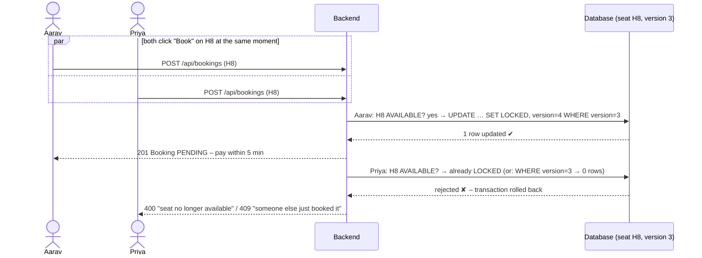

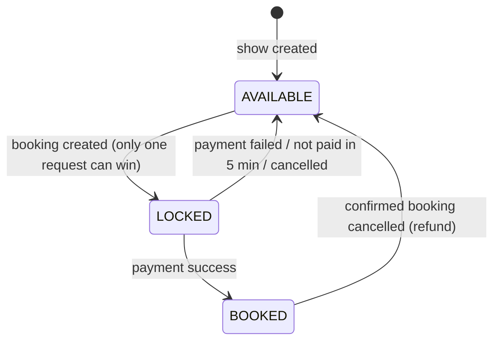

### Proof – race test on the live server

`scripts/concurrency-test.mjs` logs in 3 users and makes them request the **same seat at the same time**
(parallel requests), for 5 different seats. Result against the live deployment:

```
Show #63: Spider-Man: No Way Home @ Raj Mandir Cinema
3 users will race for each of 5 seats

✅ Seat H8: 1 booked, 2 rejected
     booked by   aarav.sharma
     rejected    priya.reddy → 400 One or more seats are no longer available.
     rejected    rohan.verma → 400 One or more seats are no longer available.
✅ Seat H9:  1 booked, 2 rejected
✅ Seat H10: 1 booked, 2 rejected
✅ Seat H11: 1 booked, 2 rejected
✅ Seat H12: 1 booked, 2 rejected

Seats now LOCKED: 5/5 (released automatically after 5 minutes if unpaid)
Result: 5/5 seats had exactly one winner
```

Every seat was given to exactly **one** user. In this run the competing requests were stopped by layer 1
(the winner had already locked the seat); layer 2 (`@Version` → 409) is the safety net for requests that hit
the database in the very same instant. Run it yourself: `node scripts/concurrency-test.mjs`

---

## 9. Security

1. **Sign up** – password is hashed with **BCrypt** before saving (never stored as plain text).
2. **Log in** – `POST /auth/login` checks the password and returns a **JWT** (a signed token, valid 24 h) plus the user's role.
3. The frontend stores the token and sends it on every request: `Authorization: Bearer <token>`.
4. `JwtAuthenticationFilter` verifies the signature and expiry on each request. Invalid or expired → **401**.
5. Role rules are enforced with `@PreAuthorize` (e.g. only ORGANIZER/ADMIN can create shows) → **403** if not allowed.
6. Users can only see **their own** bookings and payments.
7. **CORS** only allows the project's own frontend addresses to call the API.

---

## 10. Project structure

```
event-booking-system/
├── src/main/java/com/sneha/moviebooking/
│   ├── controller/      REST endpoints (Auth, Event, Venue, Seat, Show, Booking, Payment, Dashboard, Admin, Analytics)
│   ├── service/         Business logic
│   ├── repository/      Spring Data JPA repositories
│   ├── entity/          JPA entities + enums (status, roles, seat types…)
│   ├── dto/             Request / response objects
│   ├── mapper/          Entity → DTO conversion
│   ├── specification/   Dynamic filters for the /filter endpoints
│   ├── security/        JWT service, JWT filter, security + CORS config
│   ├── scheduler/       Releases unpaid bookings after 5 minutes
│   ├── config/          Swagger config, first-admin seeder, demo-data seeder
│   ├── exception/       Global error handler (JSON errors with correct status)
│   └── util/            Current-user helper
├── src/main/resources/application.properties
├── frontend/            React app (see frontend/README.md)
│   └── src/
│       ├── api.js            fetch wrapper (adds JWT, handles errors)
│       ├── auth.jsx          login state for the whole app
│       ├── components/ui.jsx reusable pieces (data loading, badges, role guard)
│       └── pages/            Events, EventDetail, SeatSelect, Payment, MyBookings, Manage, Admin, Login, Signup
├── scripts/api-smoke-test.mjs   end-to-end test of every API
├── scripts/concurrency-test.mjs race test: many users, same seat, same moment
├── docs/API.md                  endpoint reference
├── docs/screenshots/            images used in this README
├── Dockerfile                   multi-stage build (Maven → JDK image)
└── docker-compose.yml           backend + PostgreSQL for local use
```

---

## 11. Run it on your computer

### Option A – Docker (easiest: one command)

Needs [Docker Desktop](https://www.docker.com/products/docker-desktop/).

```bash
git clone https://github.com/sneha5566/event-booking-system.git
cd event-booking-system
docker compose up --build
```

- API + Swagger: http://localhost:8080/swagger-ui/index.html
- Demo data is loaded automatically. Admin login: `admin@eventbook.local` / `Admin@1234` (change with `ADMIN_EMAIL` / `ADMIN_PASSWORD`).

Then start the frontend (needs [Node.js](https://nodejs.org) 20+):

```bash
cd frontend
npm install
npm run dev          # opens on http://localhost:5173 and talks to http://localhost:8080
```

### Option B – without Docker

1. Install **Java 21** and **PostgreSQL**, create a database: `createdb eventdb`
2. Set the environment variables (see [.env.example](.env.example)):
   ```bash
   export SPRING_DATASOURCE_URL=jdbc:postgresql://localhost:5432/eventdb
   export SPRING_DATASOURCE_USERNAME=postgres
   export SPRING_DATASOURCE_PASSWORD=yourpassword
   export ADMIN_EMAIL=admin@example.com ADMIN_PASSWORD=Admin@1234
   ```
3. Run the backend: `./mvnw spring-boot:run`
4. Run the frontend as shown above.

### Configuration

| Variable | Purpose | Default |
|---|---|---|
| `SPRING_DATASOURCE_URL / _USERNAME / _PASSWORD` | Database connection | – (required) |
| `JWT_SECRET`, `JWT_EXPIRATION` | Token signing key and lifetime (ms) | dev key, 24 h |
| `ADMIN_EMAIL`, `ADMIN_PASSWORD` | Creates the first admin on startup | off |
| `CORS_ALLOWED_ORIGINS` | Frontend URLs allowed to call the API | localhost:5173 + live site |
| `DEMO_DATA_ENABLED`, `DEMO_PASSWORD` | Load demo movies/cinemas/users into an empty DB | `true`, `Demo@1234` |
| `VITE_API_URL` (frontend) | Backend URL used by the React app | `http://localhost:8080` |

---

## 12. Testing

`scripts/api-smoke-test.mjs` is an **end-to-end test** that walks through the whole system against a running backend:
sign-up → roles → events → venues → seat layout → shows (incl. overlap rule) → booking (incl. double-booking) →
payment success & failure → cancellation & refund → dashboards → analytics → seats released.

```bash
ADMIN_EMAIL=admin@eventbook.local ADMIN_PASSWORD=Admin@1234 node scripts/api-smoke-test.mjs
# add API_URL=https://… to test another server
```

It prints ✅ / ❌ for every check. A separate race test for seat locking, `scripts/concurrency-test.mjs`, is described in [section 8](#8-seat-locking--no-double-booking). Against the live deployment **all 65 checks passed**, covering every one of the 33 endpoints,
including error cases (401 without token, 403 for wrong role, 404 for missing items, 409 for duplicate email).

---

## 13. Deployment

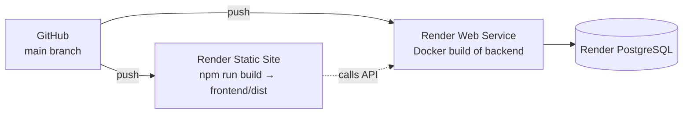

Every push to `main` automatically redeploys both parts.

| Part | Render service | Settings |
|---|---|---|
| Backend | Web Service (Docker) | env vars from the table above |
| Frontend | Static Site | root `frontend`, build `npm install && npm run build`, publish `dist`, env `VITE_API_URL`, rewrite rule `/*` → `/index.html` |
| Database | PostgreSQL (free) | free databases expire after 30 days – upgrade or recreate |

---

## 14. Work log – what was built and fixed

**Phase 1 – Backend.** Spring Boot REST API with JWT security, three roles, events, venues, seat layouts,
shows with tiered pricing and overlap checks, bookings with seat locking, mock payments, refunds,
dashboards, analytics, a booking-expiry scheduler, Swagger docs and Docker.

**Phase 2 – Review, frontend and deployment.** Every API was tested end to end; the review found and fixed these problems:

| # | Problem found | Fix |
|---|---|---|
| 1 | No API returned a show's seats, so a client could not know which seat IDs to book | Added `GET /api/shows/{id}/seats` |
| 2 | Login returned only a token, so the frontend could not know the user's role | Login now returns `token, userId, name, email, role` |
| 3 | Show APIs read lazy-loaded data after the DB session closed (`LazyInitializationException`) | Read methods made `@Transactional(readOnly = true)` |
| 4 | Every error returned 400 – even "not found" and "access denied"; duplicate sign-up returned 200 | New global error handler: 400/401/403/404/409 with JSON `{status, message}` |
| 5 | CORS did not allow `PATCH`, so changing roles failed from a browser | Added `PATCH`; allowed origins are now configurable |
| 6 | Expired/invalid JWT caused a server error instead of 401 | JWT filter catches token errors; JSON 401 response |
| 7 | No way to create the first admin | `AdminSeeder` creates one from `ADMIN_EMAIL`/`ADMIN_PASSWORD` |
| 8 | Live deployment was down: the free database had expired | New PostgreSQL database connected |
| 9 | `docker-compose.yml` still used MySQL | Switched to PostgreSQL |

Then the **React frontend** was built (all three roles), **demo data** was added, and both parts were **deployed on Render**.

---

## 15. Limitations and future work

- Payments are simulated – a real gateway (e.g. Razorpay test mode) could be plugged into `MockPaymentGatewayService`.
- No e-mail / SMS ticket confirmation yet.
- No poster images for events (field exists, UI shows a placeholder).
- No password reset, and no user deletion endpoint.
- Free hosting: cold starts (~1 min) and a database that expires after 30 days.
- Automated unit tests could be added alongside the end-to-end smoke test.

---

## 👩‍💻 Author

**Sneha Neerukonda** – Computer Science Engineering student

Licensed under the [MIT License](LICENSE).
