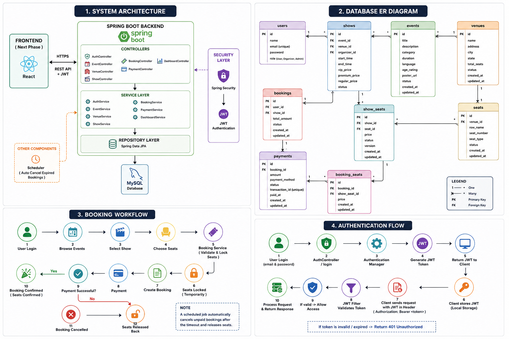

# 🎟️ Event Booking System

A production-ready Event Booking System built with Spring Boot that allows users to browse events, book seats, manage bookings, and enables organizers/admins to manage venues, shows, and events securely.

---
# 🏗️ System Architecture

The following diagram provides an overview of the Event Booking System architecture, database relationships, booking workflow, and JWT authentication flow.



## 🚀 Features

### Authentication & Security
- JWT Authentication
- Role-Based Authorization (USER, ORGANIZER, ADMIN)
- Password Encryption with Spring Security
- Secure REST APIs

### Event Management
- Create Events
- Update Events
- Delete Events
- List Events
- Filter Active Events

# 🎟️ Event Booking System


A production-ready **Event Booking System** built using **Spring Boot**, **Spring Security**, **JWT Authentication**, **Hibernate**, **MySQL**, and **Swagger**.

---

## 🚀 Features

### Authentication
- User Registration
- Secure Login
- JWT Authentication
- Role-Based Authorization

### Event Management
- Create Event
- Update Event
- Delete Event
- List Events

### Venue Management
- Create Venue
- Update Venue
- Delete Venue

### Show Management
- Create Shows
- Dynamic Pricing
- Overlap Validation

### Booking
- Seat Booking
- Booking History
- Booking Cancellation
- Double Booking Prevention

### Dashboard
- Admin Dashboard
- Organizer Dashboard
- Booking Statistics
- Revenue Statistics

### Scheduler
- Automatic Expired Booking Cleanup

---

## 🛠 Tech Stack

| Category | Technology |
|-----------|------------|
| Language | Java 21 |
| Framework | Spring Boot |
| Security | Spring Security + JWT |
| Database | MySQL |
| ORM | Hibernate |
| Documentation | Swagger |
| Build Tool | Maven |
| API Testing | Postman |

---

# 📂 Project Structure

```
src
 ├── controller
 ├── service
 ├── repository
 ├── entity
 ├── dto
 ├── mapper
 ├── security
 ├── config
 ├── util
 └── exception
```

---

# 🔐 User Roles

### USER

- Browse Events
- Book Tickets
- Cancel Booking
- View Booking History

### ORGANIZER

- Manage Events
- Manage Shows
- View Organizer Dashboard

### ADMIN

- Manage Users
- Manage Venues
- Manage Events
- View Analytics Dashboard

---

# ⚙️ Running the Project

## Clone Repository

```bash
git clone <repository-url>
```

## Navigate

```bash
cd event-booking-system
```

## Configure Database

Update:

```
src/main/resources/application.properties
```

with your MySQL credentials.

Example:

```
spring.datasource.url=jdbc:mysql://localhost:3306/event_booking
spring.datasource.username=root
spring.datasource.password=your_password
```

---

## Run

```bash
./mvnw spring-boot:run
```

or

Run `EventBookingApplication` directly from IntelliJ.

---

# 📖 API Documentation

After starting the application:

```
http://localhost:8080/swagger-ui/index.html
```

---

# 🔒 Authentication

Protected APIs require a JWT token.

Workflow:

1. Register
2. Login
3. Copy JWT Token
4. Authorize in Swagger
5. Access Protected APIs

---

# 📌 Future Improvements

- React Frontend
- Docker Deployment
- CI/CD Pipeline
- Email Notifications
- Payment Gateway Integration
- Cloud Deployment

---

# 👩‍💻 Author

**Sneha Neerukonda**

Computer Science Engineering Student

Built with ❤️ using Spring Boot.